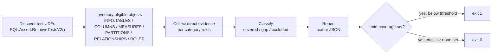
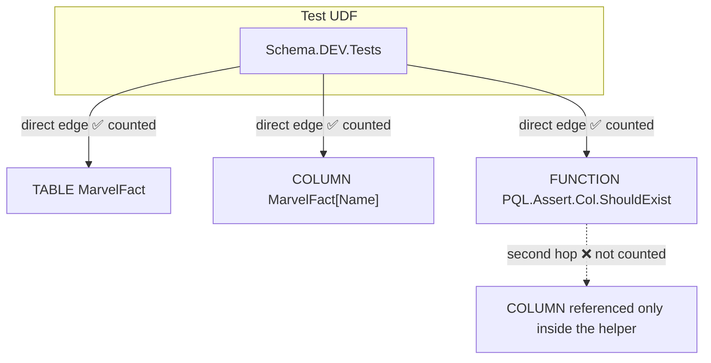
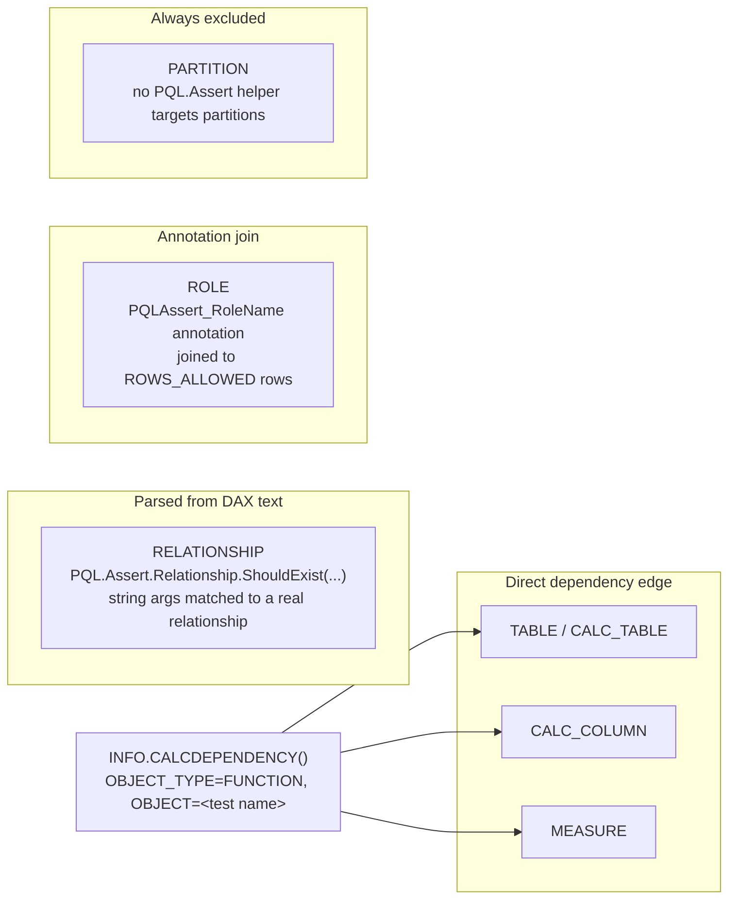
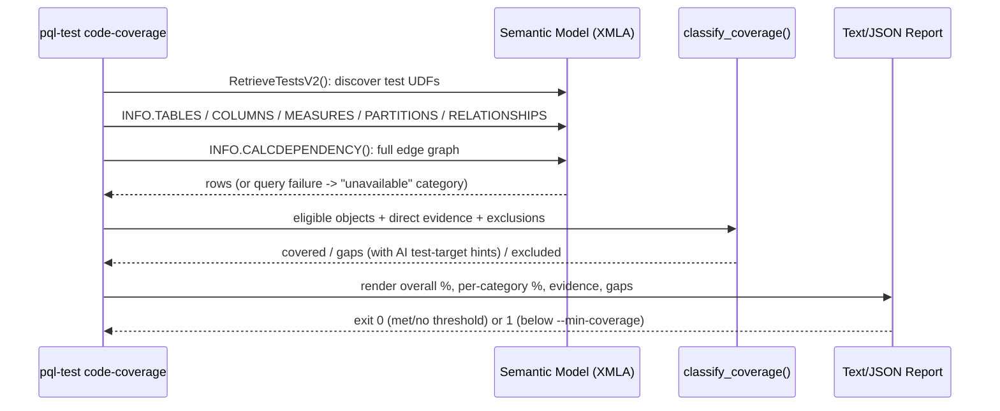

# How Code Coverage Works in pql-test

> One-pager explaining `pql-test code-coverage` for review before publishing.

## TL;DR

`code-coverage` reports **dependency coverage**, not **assertion coverage**. An
object (table, column, measure, relationship, partition, role) counts as
"covered" only when a discovered `*.Tests.dax` UDF has **direct, verifiable
evidence** that it touches that object: never because a test reaches it
*indirectly* through a shared `PQL.Assert.*` helper function, and never
inferred from multi-hop dependency chains.



## Why "direct evidence" instead of "reachable"

Every DAX test UDF calls shared helpers like `PQL.Assert.Col.ShouldExist`.
If coverage simply asked "can this object be reached from the test at all?",
*every* object touched by *any* helper call elsewhere in the model would look
covered. `pql-test` avoids that by reading `INFO.CALCDEPENDENCY()`, a flat,
one-row-per-edge dependency graph for the whole model, and keeping only the
**first hop**, where `OBJECT` is literally a discovered test name.



A chain like *test → helper → object* produces **two separate rows** in
`INFO.CALCDEPENDENCY()`. Filtering `OBJECT` down to the set of discovered test
names naturally keeps the first row and drops the second, no AST/text
parsing needed for tables, columns, or measures.

## Per-category evidence sources

Not every object type leaves a usable edge in `INFO.CALCDEPENDENCY()`, so each
category has its own verified evidence rule:



| Category | Evidence source | Never counted as |
|---|---|---|
| Table, calculated column, measure | Direct `INFO.CALCDEPENDENCY()` edge from a test UDF | Covered via a transitive/indirect reference |
| Relationship | Test UDF's own DAX expression text contains a literal `PQL.Assert.Relationship.ShouldExist(fromTable, fromCol, toTable, toCol)` call matching a real relationship | Covered just because the test calls the helper with *some* arguments |
| Role | Test UDF's `PQLAssert_RoleName` annotation matched against `ROWS_ALLOWED` rows for that role | Covered without the annotation present |
| Partition | n/a | **Never** covered or uncovered; always excluded (no assertion surface exists) |

## Classification and reporting



- A category whose metadata query fails is reported as **unavailable with a
  reason**, never silently shown as 0%.
- `--min-coverage N` rounds the overall percentage to 2 decimals and compares
  against `N`; it only rounds to 100% when every eligible object is covered,
  so `--min-coverage 100` can't pass with any gap.
- Report colors follow the same PASS/SKIP/FAIL vocabulary as `run-tests`:
  default watermarks (≥80 green, 50–80 yellow, <50 red) without a threshold,
  or binary pass/fail against `N` when `--min-coverage` is set.

## Example output

```
Overall: 10/23 covered (43.48%)

By category:
┌──────────────┬─────────┬──────────┬──────────────┐
│ Category     │ Covered │ Eligible │            % │
├──────────────┼─────────┼──────────┼──────────────┤
│ CALC_COLUMN  │       0 │        6 │         0.0% │
│ MEASURE      │       3 │        6 │        50.0% │
│ PARTITION    │       - │        - │ excluded (8) │
│ RELATIONSHIP │       3 │        3 │       100.0% │
│ TABLE        │       4 │        8 │        50.0% │
└──────────────┴─────────┴──────────┴──────────────┘
```

## What this does *not* mean

A high score only proves objects are **referenced** by a test, not that the
test's assertions **meaningfully validate** their behavior. A test that
checks "table has more than zero rows" and a test that validates every
business rule on that table both count as "covered" identically. Treat a low
score as "nothing here has been tested at all," and a high score as "at least
referenced by a test", not a correctness guarantee.

See [direct-udf-code-coverage-metadata-contract.md](../tasks/direct-udf-code-coverage-metadata-contract.md)
for the fully verified evidence contract this document summarizes, and the
[README `code-coverage` section](../README.md#code-coverage) for full CLI
flags and CI examples.
